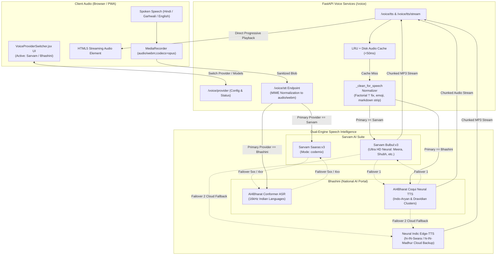

# 05. Multilingual Voice & Speech Subsystem

## 1. The Need for Low-Latency Voice (Sanjeevani Live)

In mountainous regions, typing on small smartphone keyboards is a significant friction point for rural citizens, especially:
- Elderly patients with vision impairments or tremor.
- Citizens speaking regional dialects who may not know standard Devanagari or English spelling.
- Emergency situations where fast hands-free communication is necessary.

Sanjeevani solves this with **Sanjeevani Live**, an integrated voice-in, voice-out conversational interface powered by **Sarvam AI**.

---

## 2. Speech Architecture & Pipeline



---

## 3. Speech-to-Text (STT): Multi-Engine ASR & MIME Sanitization

Implemented in [`backend/app/core/sarvam_stt.py`](file:///d:/Sanjeevani/backend/app/core/sarvam_stt.py) and [`backend/app/core/bhashini_client.py`](file:///d:/Sanjeevani/backend/app/core/bhashini_client.py).

### Symmetrical Dual-Provider ASR Architecture:
- **Sarvam Saaras v3**: High-accuracy transcription with `codemix` mode for colloquial Hindi, Garhwali regional terms, and Indian English.
- **Bhashini ASR (AI4Bharat Conformer)**: Official Government of India national speech recognition pipeline for official 8th Schedule Indic languages.
- **Automatic Mutual Failover**: If the active primary ASR provider fails (e.g., HTTP 500, network timeout, rate limit 429), the request seamlessly retries against the fallback provider without dropping the patient's consultation.

### Browser MediaRecorder MIME Sanitization:
Modern browsers capture microphone input via `MediaRecorder` using container MIME types with parameters, typically `audio/webm;codecs=opus`. 
- **The Challenge**: Strictly validated speech APIs (such as Sarvam AI) reject parameters with `400 Invalid file type: audio/webm;codecs=opus`.
- **The Solution**: Both frontend ([`voiceClient.js`](file:///d:/Sanjeevani/frontend/src/api/voiceClient.js)) and backend ([`voice.py`](file:///d:/Sanjeevani/backend/app/api/voice.py)) strip MIME parameter suffixes:
  ```python
  clean_content_type = raw_ct.split(";")[0].strip().lower()  # -> 'audio/webm'
  ```
  This guarantees standard format compliance across Chromium, Safari, Firefox, and mobile WebViews.

---

## 4. Text-to-Speech (TTS): Dynamic Voice Switching & Progressive Streaming

Implemented in [`backend/app/core/tts_engine.py`](file:///d:/Sanjeevani/backend/app/core/tts_engine.py) and [`frontend/src/components/VoiceProviderSwitcher.jsx`](file:///d:/Sanjeevani/frontend/src/components/VoiceProviderSwitcher.jsx).

### Active Models & Voice Personas:
1. **Sarvam AI (bulbul:v3)**:
   - **Female Personas**: `meera` (gentle doctor voice, default), `ananya`, `ritu`, `priya`, `kavya`, `shreya`.
   - **Male Personas**: `shubh` (senior clinical physician), `arjun`, `rahul`, `aditya`, `amit`, `dev`.
2. **Bhashini (AI4Bharat Indic-TTS)**:
   - **Neural Clusters**: `ai4bharat/indic-tts-coqui-indo_aryan-gpu--t4` (Hindi, Garhwali, Kumaoni) and `ai4bharat/indic-tts-coqui-dravidian-gpu--t4`.
   - **Genders**: Male and Female neural speakers with natural prosody.
3. **Neural Indic Edge-TTS (Offline Cloud Fallback)**:
   - Zero-configuration high-reliability cloud neural voices (`hi-IN-SwaraNeural`, `hi-IN-MadhurNeural`) serving as the ultimate fallback when both primary APIs are unreachable.

### Ultra-Low Latency Audio Caching (<50ms):
Common mission-critical phrases (greetings, emergency 108 escalation warnings, hold messages) are seeded via `seed_audio_cache()` into a differentiated LRU memory cache and on-disk audio store. Cache keys incorporate `text`, `language`, `gender`, `provider`, `model`, and `speaker` to guarantee zero playback bleeding between different voice configurations.

---

## 5. Conversational Voice Guardrails & Pronunciation Sanitization

Implemented in `IndicTTSEngine._clean_for_speech()`:
- **Exclamation Mark Normalization**: Bhashini's ASR/TTS pipeline historically expanded ASCII `!` into mathematical *"factorial"*. The cleaner normalizes `!` and `！` into natural sentence-ending periods (`. `).
- **Number & Range Formatting**: Replaces numeric ranges like `7-10` with *"7 se 10"* so the TTS engine speaks conversational Hindi instead of reading the hyphen as mathematical *"minus"*.
- **Percentage Expansion**: Translates `95%` to *"95 प्रतिशत"* in Hindi and *"95 percent"* in English.
- **Markdown & Symbol Stripping**: Cleans asterisks, hashes, backticks, emojis, and math operators (`+`, `=`, `/`) to prevent robotic verbalization of UI code artifacts.
- **Single-Question Conversational Pacing**: Voice prompts constrain LLM responses to short, conversational sentences with at most one diagnostic question per turn.

---

## 6. Sanjeevani Live Real-Time Conversational Turn-Taking & Interruption Engine

Implemented in [`frontend/src/components/LiveVoiceRoom.jsx`](file:///d:/Sanjeevani/frontend/src/components/LiveVoiceRoom.jsx) and [`frontend/src/api/voiceClient.js`](file:///d:/Sanjeevani/frontend/src/api/voiceClient.js).

The live consultation room provides an immersive, hands-free conversational voice experience using an interactive visual orb (`SanjeevaniOrb.jsx`) and strict turn-taking governance:

```
┌─────────────────────────────────────────────────────────────────────────────────────────┐
│                     SANJEEVANI LIVE CONVERSATIONAL FINITE STATE MACHINE                 │
├─────────────────────────────────────────────────────────────────────────────────────────┤
│                                                                                         │
│   ┌──────────────┐     User Spoke (VAD Debounce)     ┌──────────────┐                   │
│   │  LISTENING   │ ────────────────────────────────> │   THINKING   │                   │
│   │ (Mic Active) │                                   │ (LLM + TTS)  │                   │
│   └──────────────┘ <──────────────────────────────── └──────────────┘                   │
│          ▲           Manual / Correction Interrupt          │                           │
│          │                                                  │ Response Ready            │
│          │                                                  ▼                           │
│          │           Audio Finished (audio.onended)   ┌──────────────┐                  │
│          └─────────────────────────────────────────── │   SPEAKING   │                  │
│                      or User Tap / Orb Interrupt      │ (AEC Active) │                  │
│                                                       └──────────────┘                  │
└─────────────────────────────────────────────────────────────────────────────────────────┘
```

### 1. In-Flight Request Cancellation & Sequence Tracking
In natural speech, users frequently pause, correct themselves, or speak alternative symptoms while the assistant is processing:
- **The Challenge**: If the user submits Question 1 and then interrupts with Question 2 while the LLM is thinking, without cancellation, both requests execute concurrently. When Request 1 finishes, it speaks its response, and midway through, Request 2 speaks its answer, resulting in two overlapping voices talking at the same time.
- **The Solution**: Every conversational dispatch generates a monotonic `currentRequestIdRef` and an active `AbortController`:
  ```javascript
  const abortInFlightRequest = () => {
    currentRequestIdRef.current++;
    if (currentAbortControllerRef.current) {
      currentAbortControllerRef.current.abort();
      currentAbortControllerRef.current = null;
    }
  };
  ```
  Whenever an interruption or new question occurs, any pending HTTP inference is aborted immediately via `signal: abortController.signal`. When responses arrive from the network, stale request IDs (`requestId !== currentRequestIdRef.current`) or unmounted sessions (`!isLiveActiveRef.current`) are silently discarded, guaranteeing that **two voices can never overlap**.

### 2. Acoustic Isolation & Self-Abort Prevention
When speech is played through computer speakers, continuous microphone recognition can capture the assistant's own audio, creating an acoustic feedback loop:
- **Hardware Acoustic Echo Cancellation (AEC)**: `getUserMedia` requests native browser hardware AEC constraints:
  ```javascript
  navigator.mediaDevices.getUserMedia({
    audio: {
      echoCancellation: true,
      noiseSuppression: true,
      autoGainControl: true,
    },
  });
  ```
- **Turn Isolation**: During `thinking` and `speaking` states, native speech recognition events (`rec.onresult`) are strictly ignored, and recognition is paused. This prevents the assistant from interpreting its own spoken words as user input or prematurely self-aborting in-flight thinking requests due to trailing microphone noise.
- **Clean Resumption**: Upon audio playback completion (`audio.onended`), recognition restarts cleanly (`startListening()`) with an empty buffer for the user's next turn.

### 3. Immediate Call Termination & False-Fallback Suppression
When a patient ends the voice call:
- **Instant Audio Teardown**: `handleEndCall()` synchronously executes `stopCurrentAudio()` and `stopAllVoiceAudio()`, immediately pausing the active `<audio>` element, clearing its `src`, revoking object URLs, and cancelling `window.speechSynthesis`.
- **`AbortError` Guard**: In modern browsers, pausing a playing audio stream rejects its `.play()` promise with an `AbortError`. Previously, unhandled `.catch()` blocks interpreted this rejection as an autoplay policy block and triggered a fallback TTS client that continued speaking after call exit. The engine now explicitly intercepts `AbortError` and skips fallbacks during intentional halts:
  ```javascript
  audio.play().catch((playErr) => {
    if (playErr?.name === 'AbortError' || !isLiveActiveRef.current) return;
    fallbackToVoiceClient(fallbackText);
  });
  ```

